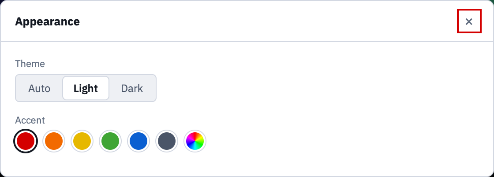

# Appearance

How the window looks, and the **?** marks that open this manual.

**Appearance** at the bottom left opens both settings. They are kept in
`~/.openetv/prefs.json` and apply the next time as well.

## Theme

**Auto** follows the system, **Light** and **Dark** override it. The window
changes at once; nothing has to be confirmed, because the window is the
preview.

The heatmaps and the curve stay dark in every theme. Their colours are chosen
for a dark background, and one set of them is enough that way.

## Accent

The accent marks what to do next — the primary button of a step — and nothing
else. Pick one of the offered colours or any colour of your own with the last
swatch.

Whatever you pick stays readable: the app derives four roles from your one
colour per theme, making it lighter or darker in small steps until the text on
a panel reaches a contrast of 4.5:1 and a filled button 3:1. Yellow, white and
black are usable choices for that reason.

The states — ready, a suspect value, an error — never use the accent. An error
has to stay recognisable whatever accent is set, and it is never told by
colour alone: it comes as a sentence with a sign.

## The ? marks

**Help** shows a small **?** at each step, which opens this manual at the page
for it. Switch it off when you know your way around; the **Manual** button
beside it opens the manual at its index either way.

## Where the look comes from

OpenETV shares its look with its sister app, Race Analysis: the same
stylesheet, the same typeface (IBM Plex) and the same icons, copied file for
file. Both ship the fonts instead of loading them from the network, so the app
works offline and looks the same everywhere.
