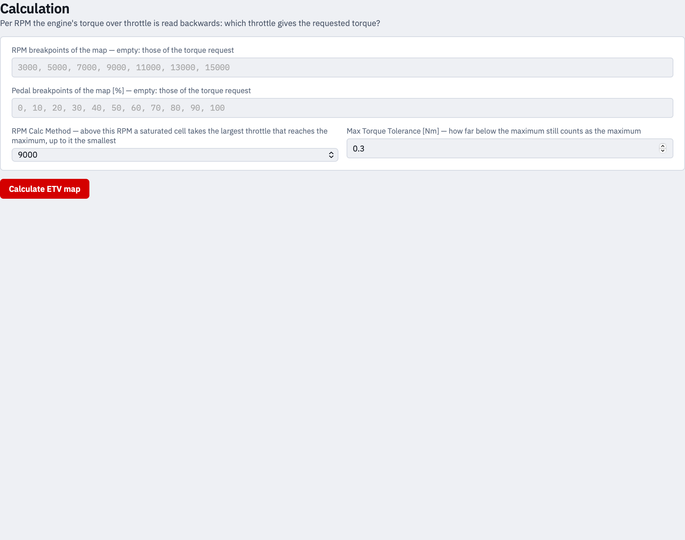

> Archived browser interface. For the native app, use the [current manual](../../rust/MANUAL.md).

# 3 · Calculation

Here the map is computed: per engine speed the app reads the engine's torque
curve over throttle backwards and asks which throttle gives the requested
torque.

## The breakpoints of the map

**RPM breakpoints of the map** and **Pedal breakpoints of the map [%]** say
what grid the result gets. Left empty, the result takes the grid of the torque
request — which is usually what you want, because the ECU's map has that grid.

Type them separated by commas. Both tables are read at the exact engine speed
of an output row, the engine torque interpolated linearly between its rows, as
the ECU reads its own table. Engine speeds outside the engine table are named
in a warning on the result: there its first or last row is held, and what the
engine really gives at those revs is not known.

## RPM Calc Method

Above the chosen engine speed a saturated cell takes the **largest** throttle
that reaches the maximum; up to it the **smallest**.

This matters where the engine's torque no longer rises: at low revs the
smallest opening that reaches the maximum is the right answer, because opening
further gives nothing and only makes the map coarse. High up the largest is
wanted, so the rider reaches 100 % throttle at full grip.

## Max Torque Tolerance

How far below the maximum still counts as the maximum, in Nm.

The case it is there for: an engine peaks at 90 % throttle with 55.9 Nm and
gives 55.4 Nm at 100 %. Without a tolerance the map answers 90 % at full grip,
which is correct and feels wrong — the grip is wide open and the throttle is
not. A tolerance of 0.5 Nm or more makes the cell 100 %.

The default is 0.3 Nm.

## Calculating

**Calculate ETV map** computes the map and shows step 4. If a table cannot be
calculated with — an empty cell, a breakpoint twice — the app says which and
computes nothing.

Whenever a table or a setting changes afterwards, the result is marked as out
of date: the sidebar says so, the map is dimmed, and a red notice stands above
it. Calculate again before you use it.
