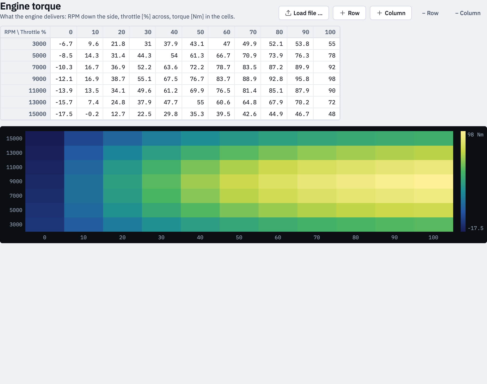

> Archived browser interface. For the native app, use the [current manual](../../rust/MANUAL.md).

# 1 · Engine torque

What the engine really delivers: rows are engine speed, columns are throttle
position in %, and a cell holds the torque in Nm. It comes from an engine or
rolling dyno. Everything the app computes rests on this table.

## Editing the table

Click a cell and type. The number is taken while you type, so the lines on the
left and the heatmap below follow at once.

- **Enter** moves down, **Shift+Enter** up, **Tab** to the right.
- **Escape** puts the old number back.
- A decimal comma is understood: `12,5` is `12.5`.
- What is not a number is framed in red and is **not** taken into the table —
  the old value stays until you type one.

The first row and the first column hold the **breakpoints**. They are taken
when you leave the cell, not while you type, because a changed breakpoint
moves its row or column to where it belongs.

### Pasting from a spreadsheet

Select the block in Excel or Numbers, copy it, click the cell where its top
left corner should land, and paste. Rows and columns that reach beyond the
table are dropped; cells that are no numbers are counted in a notice and stay
as they were.

You can paste the breakpoints along with the values: click the corner cell
before pasting, and the first pasted row becomes the throttle breakpoints, the
first column the engine speeds.

### Rows and columns

**+ Row** and **+ Column** add one at the end, one step further on than the
last two breakpoints, with the values of the row or column before it.
**− Row** and **− Column** remove the one your cursor was last in. A table
always keeps at least one row and one column.

## Loading a table

**Load file …** reads CSV, Excel and Mectronik `.dss`; a file dropped on the
window is loaded as well. What the app expects of a file is in
[Files](files.md).

A `.dss` may hold several tables. The app lists them and you pick one.

## What the table's shape means

- **Negative torque at closed throttle** is the engine braking itself, and it
  is the reason a request of 0 Nm is not 0 % throttle. Tables cut at 0 Nm are
  just as valid — engine-brake design is kept apart from gas design, and many
  ECU exports hold the positive part only. Either way the map needs the
  [zero-gas fix](etv-map.md#zero-gas-fix) at the end.
- **A row that sags after its peak** is normal: many engines give a little
  less at full throttle than at 80 or 90 %. The app inverts such a row on the
  way up from closed throttle — the smallest throttle that delivers the
  torque — and marks the cells where the engine falls below the request again
  further open.
- **Engine speeds the table does not have** are interpolated between its rows.
  Rows that hold no torque at all do not count, so a dummy row at 0 rpm, as
  ECU exports often carry, does not pull its neighbours down.

## The heatmap

Below the table the same numbers as a picture: engine speed upwards, throttle
across, the value as a colour. The ramp runs from dark to light, so it reads
without colour as well; its ends are written beside it.
