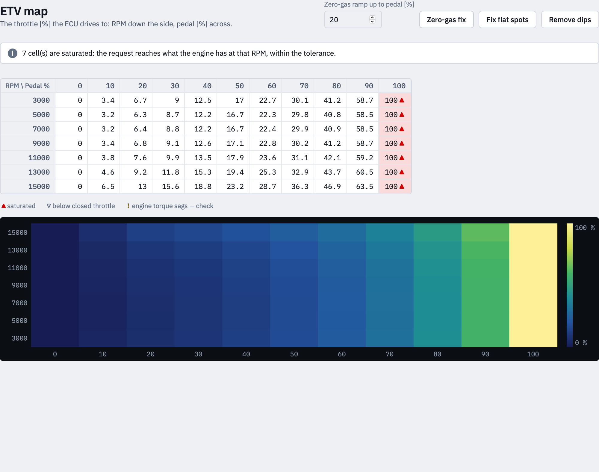

> Archived browser interface. For the native app, use the [current manual](../../rust/MANUAL.md).

# 4 · ETV map

The result: the throttle position in % the ECU drives to, over engine speed
and pedal. It can be read, checked, fixed and edited by hand.

## What the marks mean

A cell says by a sign what happened in it — not by colour alone:

- **▲ saturated** — the request reaches what the engine has at that engine
  speed, within **Max Torque Tolerance**. Which throttle was chosen follows
  [RPM Calc Method](calculation.md#rpm-calc-method).
- **▽ below closed throttle** — the request is below what the engine gives
  with the throttle shut (its engine braking); it cannot close further, so the
  cell is 0 %.
- **! engine torque sags — check** — the engine's torque falls below the
  request again at a larger throttle. The app used the smallest throttle that
  delivers the torque, which is right, but the row is worth a look on the dyno.

Above the table the same is written out, with how many cells each concerns.

## Editing by hand

Cells can be typed into like any other table. That is meant for the last
touch-ups after the fixes — the marks stay as the calculation set them, so you
still see what a cell was.

A map edited by hand is not recalculated. Calculating again starts from the
tables and throws the edits away.

## Zero-gas fix

A request of 0 Nm is not 0 % throttle: with a table that holds engine braking,
zero torque sits somewhere above the closed throttle. Left alone, the bike
would keep pulling with the grip shut.

**Zero-gas fix** sets the pedal 0 % column to 0 % throttle and lets the
throttle rise from there in a **straight line** up to the pedal breakpoint
nearest to **Zero-gas ramp up to pedal [%]** (20 % by default). Without that
ramp a step of several per cent throttle would sit between the closed grip and
the next breakpoint.

How far the ramp should reach is a judgement: along it the map no longer
follows the torque request, so not further than needed; too short, and the
first degrees of grip give a step in torque.

## Fix flat spots

A flat spot is a plateau — the grip moves and the throttle stands still. The
rider feels nothing happen, and on the way back the throttle follows late.

**Fix flat spots** replaces every plateau by a straight line up to its last
cell. The last cell keeps its value; the cells before it therefore give a
little less throttle than was calculated, which is why the app asks you to
check them.

## Remove dips

**Remove dips** makes the throttle never fall as the pedal rises: the running
maximum along each row. It removes dips, where **Fix flat spots** removes
plateaus — two different jobs.

## The map is out of date

If a table or a setting changes after the map was calculated, the map is
dimmed, the sidebar says **out of date — calculate again**, and a red notice
stands above the table. Saving it is still possible, but the app asks first.
