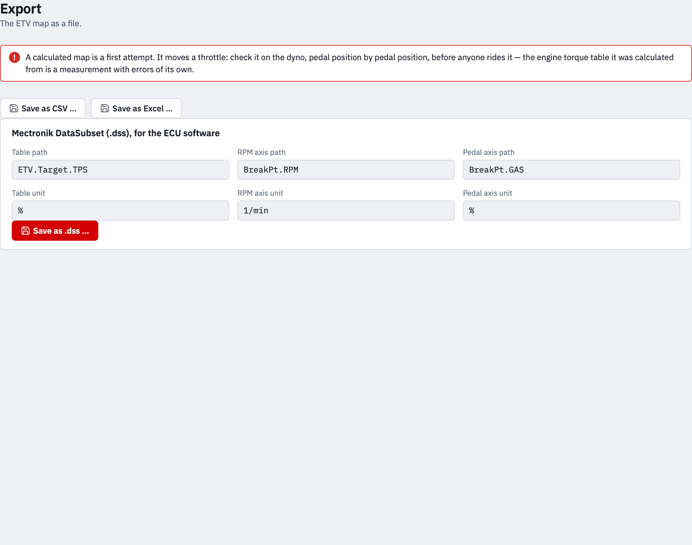

# 5 · Export

The finished map as a file — for the ECU software, or for a spreadsheet.

## Check it on the dyno first

A calculated map is a first attempt. It moves a throttle, and it was computed
from a dyno measurement that has errors of its own. Check it on the dyno,
pedal position by pedal position, before anyone rides it: hold a grip position
and see whether the torque that comes out is the torque the request asked for.
Expect to correct a line or two.

The app says the same above the buttons, every time.

## Mectronik DataSubset (.dss)

The format the ECU software (Mecal) imports. Six fields say where the table
belongs in the ECU:

| Field | What it is | Default |
| --- | --- | --- |
| **Table path** | the name the ECU software expects | `ETV.Target.TPS` |
| **RPM axis path** | the breakpoint vector of the engine speed | `BreakPt.RPM` |
| **Pedal axis path** | the breakpoint vector of the pedal | `BreakPt.GAS` |
| **Table unit** | the unit of the map | `%` |
| **RPM axis unit** | | `1/min` |
| **Pedal axis unit** | | `%` |

If the torque request was loaded from a `.dss`, the axis fields start with
what that file said — its own names, so the map fits back into the same
project. The file is named after the table path.

## CSV and Excel

**Save as CSV …** and **Save as Excel …** write the same table: the pedal
breakpoints across the top row, the engine speeds down the first column.
Useful for a second pair of eyes, for a dyno protocol, or for comparing two
maps in a spreadsheet.

## Where the file goes

In the app a save dialog asks where to put it. In a browser — if you started
the app with `--browser` — the file is handed to the browser's downloads
instead, because a page in a browser cannot write where it likes.
