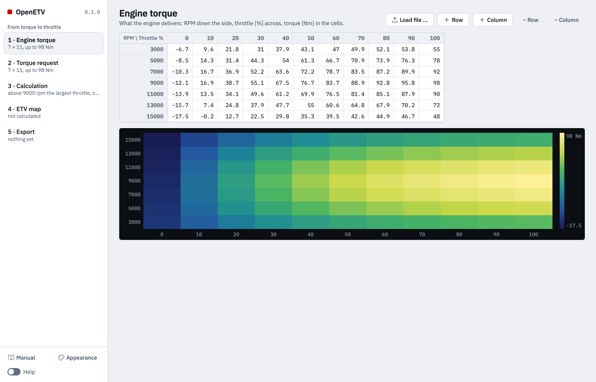

> Archived browser interface. For the native app, use the [current manual](../../rust/MANUAL.md).

# Getting started

OpenETV computes the throttle map of a ride-by-wire ECU: how far the throttle
has to open, at every engine speed and grip position, for the engine to
deliver the torque the rider asks for.

## What the app is for

A ride-by-wire ECU does not pass the grip through to the throttle. It reads
the grip as a **torque request** and opens the throttle as far as the engine
needs to deliver that torque. Three tables are involved:

| Table | Rows × columns | The value in a cell |
| --- | --- | --- |
| Engine torque | RPM × throttle % | the torque the engine delivers, in Nm |
| Torque request | RPM × pedal % | the torque the rider asks for, in Nm |
| ETV map (the result) | RPM × pedal % | the throttle % the ECU drives to |

OpenETV computes the third from the first two. Per engine speed it reads the
engine's torque curve backwards: *which throttle gives this torque?*

What the bike feels like is decided in the **torque request**. The ETV map
only makes the engine follow it.

## Installing

Take the file for your system from a release; nothing else has to be
installed, Python included.

- **macOS** — open the `.dmg` and drag OpenETV to Applications. The app is not
  signed, so the first start is refused with a warning: right-click the app,
  choose **Open**, and confirm once. After that it starts normally.
- **Windows** — unpack the `.zip` anywhere and start `OpenETV\OpenETV.exe`;
  the `_internal` folder next to it has to stay there.
- **Linux** — unpack the `.tar.gz` and start `OpenETV/OpenETV`.

The app runs on your own machine and talks to nothing. Theme and accent are
kept in `~/.openetv/prefs.json`; apart from the files you save yourself,
nothing else is written.

## The window

On the left are the five steps, each with a line on how it stands — the size
of a table, the settings of the calculation, whether a map has been
calculated. Click a step, or move through them with the arrow keys, to show it
on the right.

## A first map

The window starts with two sample tables, so nothing is empty:

1. **1 · Engine torque** — replace the sample with your own dyno table:
   **Load file …**, or paste it from a spreadsheet. See
   [Engine torque](engine-torque.md).
2. **2 · Torque request** — open **Generate a request from the engine table**,
   pick a shape, and click **Generate request**. See
   [Torque request](torque-request.md).
3. **3 · Calculation** — leave the breakpoints empty to take those of the
   request, and click **Calculate ETV map**.
4. **4 · ETV map** — read the notices, then apply **Zero-gas fix** and, if the
   map has plateaus, **Fix flat spots**. See [ETV map](etv-map.md).
5. **5 · Export** — save the map as `.dss` for the ECU software, or as CSV or
   Excel.

Then take the map to the dyno before anyone rides it. It is calculated from a
measurement that has errors of its own.
