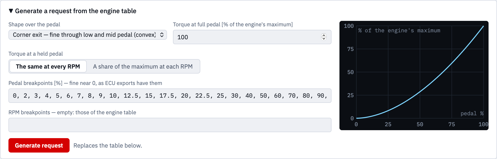

# 2 · Torque request

What the rider asks for: rows are engine speed, columns are the pedal (the
grip) in %, and a cell holds the torque in Nm that this grip position means at
that engine speed. This table, not the throttle map, decides what the bike
feels like.

The table is edited, pasted and loaded exactly like the
[engine torque table](engine-torque.md#editing-the-table).

## Generating a request

**Generate a request from the engine table** builds a whole request from a
shape over the pedal. Open it, set the shape, and click **Generate request**.
The table below is replaced.

### The shape over the pedal

- **Linear** — the same gain throughout.
- **Like a cable** — most of the torque comes early in the travel, as a
  cable-operated throttle delivers it.
- **Corner exit** — fine through low and mid pedal, steep only once you commit
  to full power. The precise dosing sits where a rider needs it out of a
  corner.
- **S-curve — a fine zone of your own** — you set where the fine zone ends
  (**End of the fine zone [% pedal]**) and how sharply it gives way to full
  power (**Sharpness of the transition**).

The curve on the right shows the shape as you change it: pedal across, share
of the engine's maximum upwards.

### Torque at a held pedal

This is the point of a torque request, so the app asks it plainly:

- **The same at every RPM** (the default) — full pedal asks for the engine's
  one maximum, and the same pedal means the same Nm at every engine speed,
  capped where the engine has less. The rider holds the grip and the torque
  stays where it is, even as the revs rise. This is the base every other
  design is built on.
- **A share of the maximum at each RPM** — every engine speed uses the whole
  pedal travel, scaled to what it can give. The torque at a held grip then
  follows the engine's torque curve again while the revs rise, as with a
  cable, which is the very thing a torque request is there to remove. Pick it
  knowingly.

**Torque at full pedal [% of the engine's maximum]** caps the request below
the engine's maximum — 90 % gives a gentler map with the same shape.

### The breakpoints

**Pedal breakpoints [%]** are set fine near 0 by default, the way real ECU
exports have them: the first degrees of grip are where a rider feels the most.
**RPM breakpoints** empty means those of the engine table.

## What is not a torque request

A table in **%** is a throttle map — the *result* of this calculation, not its
input. If a `.dss` says `%`, the app refuses it as a request and says so
instead of computing a map that looks plausible and means nothing. Files
exported by an ECU are often named "demand" and still hold throttle in %;
check the unit.
