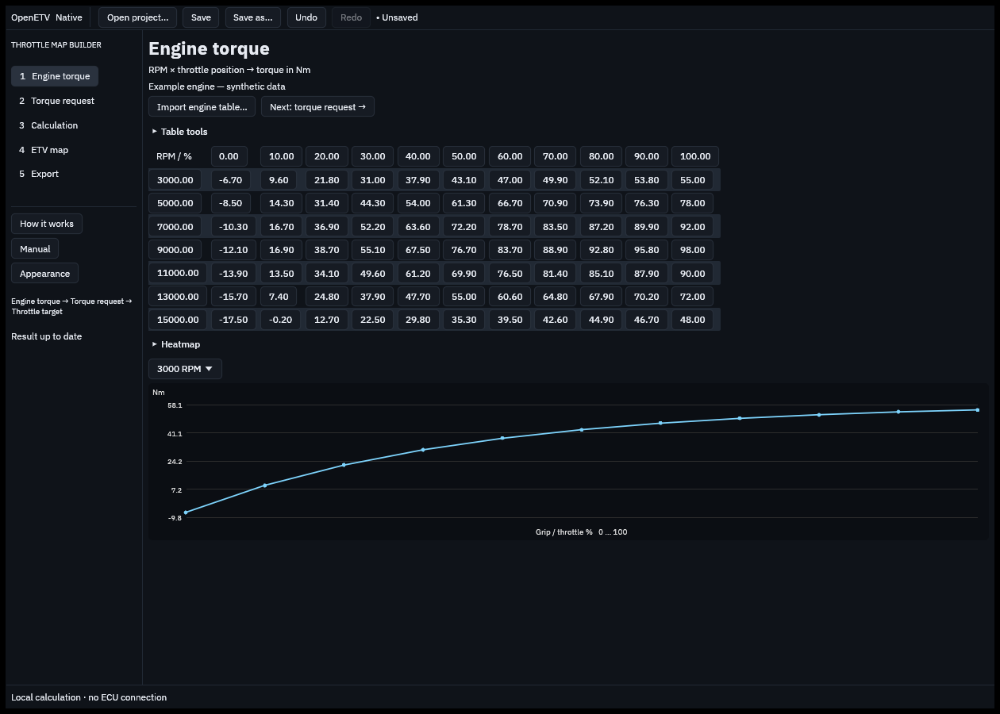
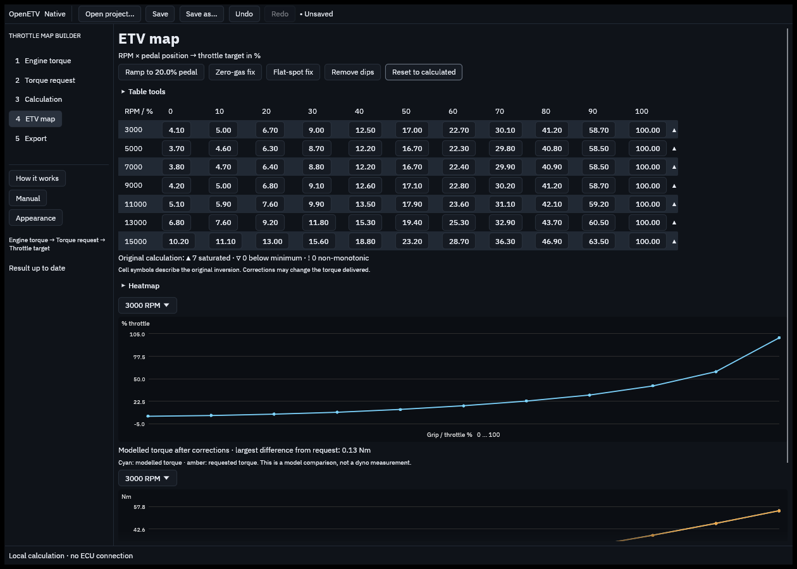
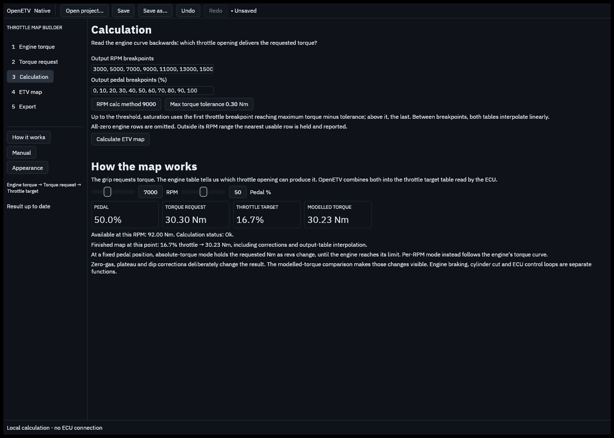

# Native OpenETV views

Rendered from the native egui interface with the bundled synthetic examples.
The software renderer checks layout without opening a desktop window; font
blending can differ slightly from the actual GPU-rendered app.

## Engine torque

## ETV result

## Working principle

